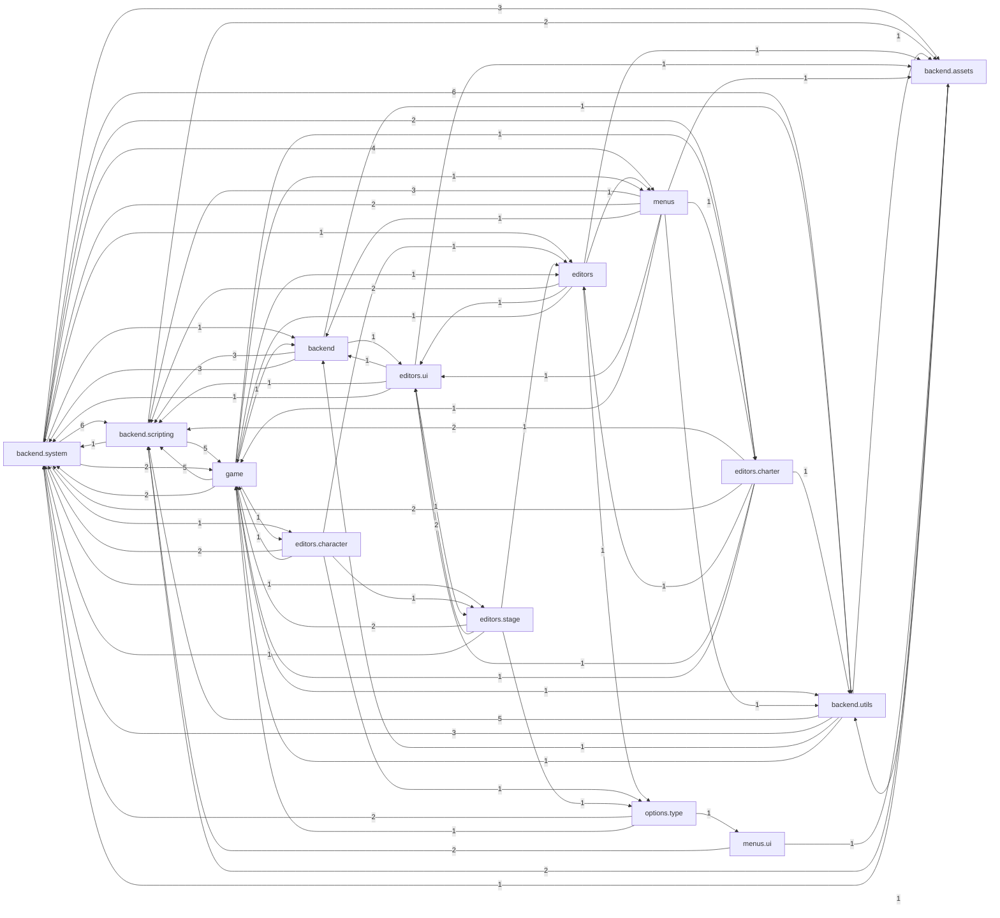

# 源码包依赖图

按包聚合的 import 关系（箭头 = A 依赖 B，数字 = 引用次数）。只统计 `funkin.*` 内部依赖，
外部库（flixel / openfl / lime）不计。

完整交互版见 [CODE_MAP.html](CODE_MAP.html)（69 个包、232 条依赖，可拖拽缩放）。



## 说明

- 节点名省略了 `funkin.` 前缀
- 只画了文件数最多的 14 个包，其余在交互版里
- 颜色分组：核心/加密容器、编辑器、菜单与设置、游戏逻辑、其他

## 各层职责

| 层 | 包 | 做什么 |
| --- | --- | --- |
| 入口 | `backend.system.Main`、`MainState` | 窗口、启动、状态切换 |
| 资源 | `backend.assets` | mod 包（CNEZ 容器、AES/zipcrypto）、SysZip、缓存 |
| 脚本 | `backend.scripting` | HScript、容器（CNX2）、事件系统 |
| 游戏 | `game`、`states`、`objects` | 音符、角色、舞台、播放状态 |
| 界面 | `menus`、`options` | 主菜单、设置、暂停 |
| 工具 | `backend.utils`、`backend.system` | 窗口、控制台、日志、更新 |

## 本 fork 新增的主要文件

集中在两个位置：

```
backend/assets/        CnezV2, ModPackCrypto, ModPackSelfTest, ZipAes, ZipPassword,
                       SysZip, OverlayZipFolderLibrary, ZipEditCache, ProtectedBuffer
backend/scripting/     crypto/ScriptCrypto, bytecode/ScriptContainer
backend/system/        IntegrityCheck, RuntimeDirs
editors/               EncryptionEditor
menus/                 ModPackKeyState, ModPackLoadingState, ModPackCleanupState,
                       ModPackMergeState, IntegrityScreen, SongLoadingScreen,
                       PopupScreen (+ PopupProgress): 新界面共用的原版弹窗外壳
```

架构接缝（改了官方文件的哪几处）见 [ARCHITECTURE.md](ARCHITECTURE.md)。
